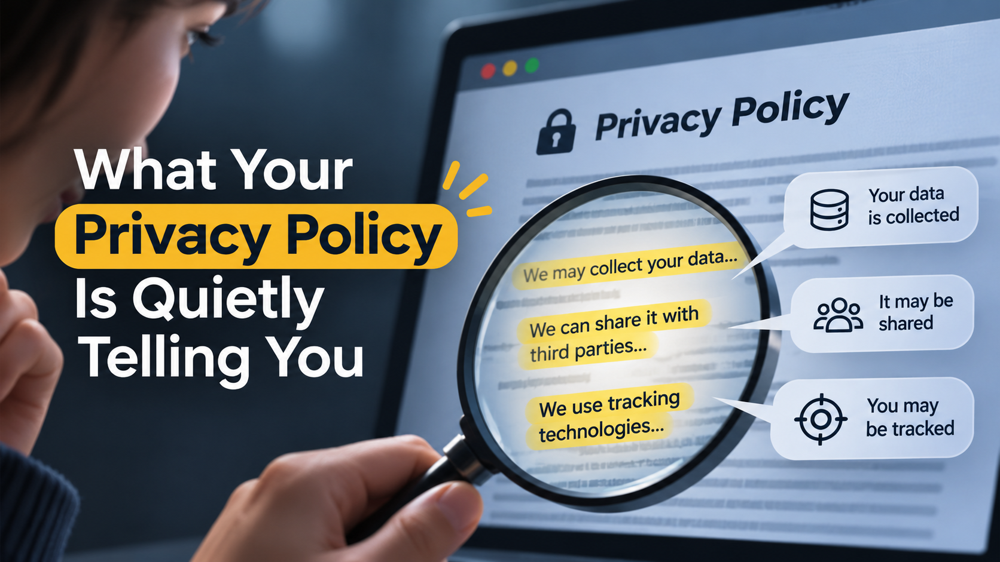

Every time you sign up for an online service, you need to acknowledge the terms and conditions and the privacy policy. Although the terms and conditions are more for protecting the service provider (they set rules for using the service and limit the company's liability if something goes wrong), the privacy policy is for end users, customers like you and me. It is usually legally required. Laws like GDPR (EU), CCPA (California) and the APPs (Australia) require businesses collecting personal data, such as emails, names or usage info, to clearly explain what they collect, why, how long they keep it, who they share it with and what rights users have. This is awesome, isn't it? Your personal boundary is respected in the digital world.

**What can you learn from the privacy document?**

You can find the business name. A brand name is not usually equal to the company name, which is not necessarily equal to the business name, so this is your chance to understand which entity is collecting your personal information. This is helpful because you can then look up where the company is located and how big it is. Even though privacy law applies based on where the customers are, not where the company is, I find it relevant that a company tends to behave better if its physical office is in a more privacy-aware environment. Another dimension is maturity: it indicates how well privacy matters can be executed, and the headcount of the business is usually a good indicator of it.

Privacy law varies from region to region, so sometimes you can infer whether an online service targets your home country by looking at how its privacy document is laid out. For example, if GDPR is mentioned, then the service is likely ready for EU customers. This matters because even though an online service can easily go global, its legal compliance might lag behind. Most of the time it's not a big deal, but if you really care about your personal rights, it's an angle to review software before you get into it.

Most importantly, you need to read what personal data they are collecting and for what purpose. You might be surprised how extensively they collect. It's usually beyond the information you put into a sign-up form or share through social login. Because of sophisticated observability tools used for performance troubleshooting, a service might collect your device metadata without your awareness. Down the track, you might also be interested in data retention. You would assume your data will be disposed of once it's no longer needed, and that you have the right to request deletion whenever you want. The reality might terrify you when you find a privacy policy explicitly saying your data can stay on their servers for as long as they want. Wow.

Under most circumstances, we cannot do much except accept the privacy policy, as we need to use the service. However, given the advancement of AI, competition between products is becoming hyped, and there is a chance privacy control could become a differentiator among services. At the very least, we can use AI to better understand what we are signing up to!
