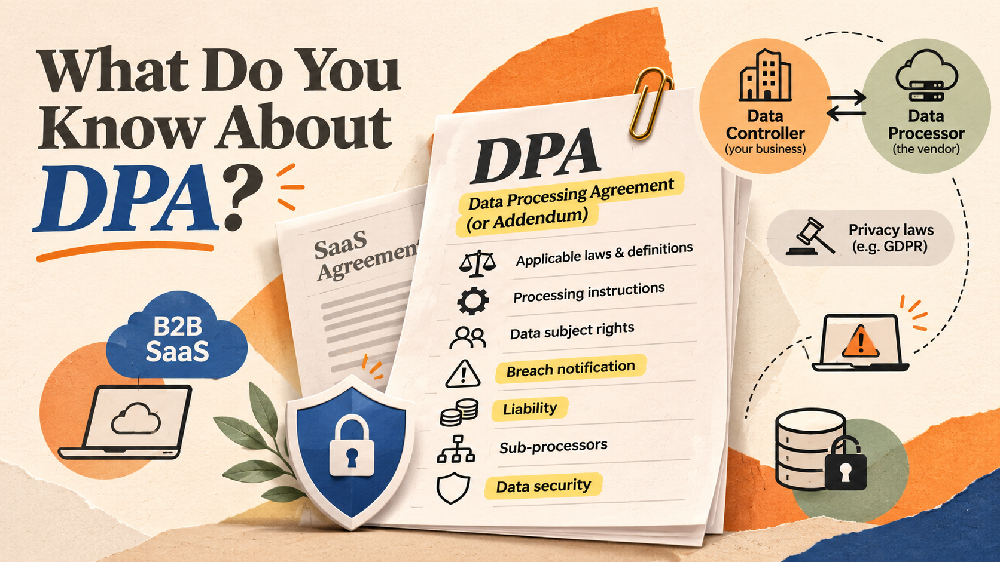

In my last post I wrote about the privacy policy, the document a service shows to you as an end user. There is a sibling document that most people never see, but it matters a lot once you start selling or buying software for business: the **DPA**.

DPA stands for either **Data Processing Agreement** or **Data Processing Addendum**. People use the two interchangeably, but they are slightly different things.

## Agreement vs. Addendum

A **Data Processing Addendum** is attached to an existing main contract, such as a SaaS subscription agreement or a master services agreement. It adds data protection terms on top of that contract, and it usually says that if the two conflict on privacy matters, the addendum wins. This is the most common format for software vendors, because they can bolt it onto their standard terms without rewriting them.

A **Data Processing Agreement** is more often a standalone contract. It may be signed separately, sometimes even when no other contract exists between the parties, or when the data processing relationship deserves its own document.

In practice you will see "DPA" on a vendor's legal page and not care much which word the "A" stands for. What matters is whether one is in place.

## Why B2B needs one, but B2C usually doesn't

For B2C SaaS, a privacy policy alone is usually enough to explain how the service handles your data. The company collects the data from you directly and decides what to do with it.

B2B is different. When a business buys a service, the vendor processes personal data on behalf of that business, for example the business's own customers or employees. In privacy law terms, the business is the **data controller** and the vendor is the **data processor**, so there is a delegation of data processing from one to the other. Privacy laws such as GDPR do not leave that delegation to goodwill. They mandate a contract that spells out the obligations on data handling, and that contract is the DPA.

## What is inside a DPA?

The details differ from vendor to vendor, but most DPAs cover the same ground:

- **Applicable laws and definitions.** Which privacy laws apply, and what terms like business day, data controller, data processor, data subject, personal data and personal data breach mean in this contract. It sounds boring, but a shared vocabulary avoids a lot of arguments later.
- **Processing instructions.** What data is processed, for what purpose, for how long, and the fact that the processor only acts on the controller's documented instructions.
- **Data subject rights.** How the processor helps the controller respond when someone asks to access, correct or delete their data.
- **Breach notification.** The procedure and the timeframe for the processor to tell the controller when something goes wrong, and what each party must do next.
- **Liability.** Last but not least, how much each party is on the hook for if a breach does happen. Vendors usually try to cap this, which is worth reading carefully.

Depending on the vendor, you might also find sections on security measures, sub-processors (the vendors of your vendor), cross-border data transfers and what happens to your data when the contract ends.

## Why it matters more now

AI is evolving at light speed, and so are the security threats powered by it. Every organisation is under increasing pressure to protect the data it holds, including the data it has handed to someone else.

When a vendor is the source of a breach, the DPA is mostly what you can refer back to. It tells you what they promised, how fast they should have told you, and who pays. So the next time a vendor sends one over, don't just click through. It might be the most useful document you read that week.
